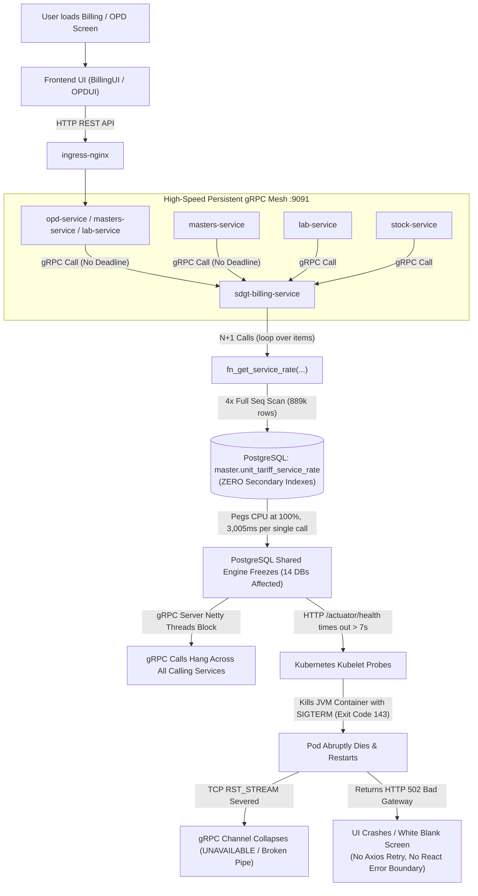

# Final Technical Investigation & Developer Remediation Report: Sriphat SIT

**Document Version:** 1.0.0  
**Environment:** Sriphat SIT Kubernetes Cluster (`smc-his-sit-*`)  
**Target Repository:** `d:\m1 repo\Releases\sriphat-sit`  
**Investigation Mode:** 100% Read-Only Inspection (No cluster state or repository files modified)  
**Target Audience:** Lead Developers, Software Engineers, DevOps Engineers, System Architects  

---

## 1. Executive Summary: The Root Cause & Domino Failure Chain

The screen freezes, blank screens, and service restarts experienced by users on Sriphat SIT are caused by a **multi-tier dependency collapse**:



---

## 2. Special Clarification: The Internal gRPC Architecture

### 2.1 Why gRPC is Central to This Incident
Unlike standard HTTP REST (which creates independent, short-lived requests), **gRPC runs over persistent, multiplexed HTTP/2 TCP streams**.

In `sriphat-sit`, `sdgt-billing-service` is the **core gRPC hub** of the hospital system:
* **`masters-service`** connects to `sdgt-billing-service` on port `9091` (`SPRING_GRPC_KUBERNETES_BILLING_DNS`)
* **`opd-service`** connects to `sdgt-billing-service` on port `9091` (`SPRING_GRPC_KUBERNETES_BILLING_DNS`)
* **`lab-service`** connects to `sdgt-billing-service` on port `9091` (`SPRING_GRPC_KUBERNETES_BILLING_DNS`)
* **`stock-service`** connects to `sdgt-billing-service` on port `9091` (`SPRING_GRPC_KUBERNETES_BILLING_DNS`)
* **`sdgt-billing-service`** connects back to `stock-service` on port `9094` (`SPRING_GRPC_KUBERNETES_SERVICE_DNS`)

### 2.2 What Happens During the Slowdown and Restart
1. **gRPC Server Thread Starvation:**  
   When `sdgt-billing-service` executes `fn_get_service_rate`, its worker threads block waiting on PostgreSQL (which takes 3+ seconds per lookup). Incoming gRPC requests from `opd-service`, `masters-service`, and `lab-service` queue up in Netty's event loop until all available gRPC threads are saturated.
2. **Missing Client-Side Deadlines:**  
   In gRPC, if a client stub call does **not** specify a deadline (e.g., `.withDeadlineAfter(5, TimeUnit.SECONDS)`), **the client thread will wait indefinitely**. Because `masters-service` and `opd-service` wait on `sdgt-billing-service`, their own worker threads freeze.
3. **Abrupt Connection Severing (SIGTERM 143):**  
   When Kubelet terminates `sdgt-billing-service` due to the `/actuator/health` timeout, the HTTP/2 connection is abruptly terminated with a TCP `RST` / `FIN`.
   - All active in-flight gRPC streams on `masters-service`, `opd-service`, and `lab-service` immediately fail with `io.grpc.StatusRuntimeException: UNAVAILABLE: channel is shutting down` or `Connection reset by peer`.
   - If the calling service does not wrap the gRPC stub in a try-catch / fallback, the unhandled exception crashes the calling API request and bubbles up as an HTTP 500 to the user.
4. **Thundering Reconnection Storm:**  
   Notice the DNS configuration: `static://sdgt-billing-service.sit.svc.cluster.local:9091`. When the new billing pod comes up with a new IP, all 4 calling microservices hammer Kubernetes CoreDNS and attempt simultaneous HTTP/2 handshakes, causing CPU spikes during container initialization.

---

## 3. Direct Answers to the 4 Developer Questions

### Q1: Can we handle temporary service failures at the application/UI level so users don't experience screen-level issues?
**Yes.**  
Currently, when a backend service restarts or experiences a gRPC timeout, Ingress returns `502 Bad Gateway` or `504 Gateway Timeout`. The frontend UI has **no retry interceptor** and **no React Error Boundary**, so the unhandled rejection crashes the page (blank/white screen).  
* **Remediation:** Configure `axios-retry` for idempotent requests (3 retries with exponential backoff: 500ms, 1500ms, 3000ms), and wrap data tables in React Error Boundaries displaying non-blocking retry alerts instead of crashing.

### Q2: Can we separate liveness and readiness health checks instead of using `/actuator/health` for both?
**Yes, and this is mandatory.**  
`/actuator/health` checks DataSource/database connectivity. When PostgreSQL slows down or connections exhaust, `/actuator/health` takes >7 seconds to respond or returns `503 DOWN`. Because Kubelet uses this for **liveness**, it mistakenly kills healthy JVM processes (`Exit Code: 143`).  
* Spring Boot **already exposes** `/actuator/health/liveness` (which checks only JVM internal state and **ignores DB latency**). Pointing liveness to `/actuator/health/liveness` immediately prevents unnecessary restarts.

### Q3: Can we compare the current deployment image with the previous stable image?
**Yes.**  
* `sdgt-billing-service`: Running `Sriphat-SIT-00e25d7-1795419355` (deployed Nov 23). Previous stable was `Sriphat-SIT-77f66b3-1794908484` (Nov 17).
* `opd-service`: Running `Sriphat-SIT-54d541e-1795448432` (deployed Nov 23). Previous stable was `Sriphat-SIT-18f2a39-1794816627` (Nov 17).
* `medcare-frontend`: **Deployment is currently blocked in FluxCD** due to an invalid host string (`https://mykare-sit.sriphat.com`) in `medcare-frontend-helmrelease.yaml`.

### Q4: Should we review PostgreSQL CPU utilization and tariff-rate processing?
**Yes — This is the primary root cause.**  
Table `master.unit_tariff_service_rate` in the `Billing` database contains **889,078 rows** and has **ZERO secondary indexes** (only primary key `id`). Every tariff rate calculation runs `transaction.fn_get_service_rate(...)`, which performs **4 sequential table scans (~3.5 million rows scanned)** taking **3,005 ms** per single lookup. The backend calls this in an N+1 loop for every service item, completely saturating PostgreSQL CPU.

---

## 4. How Services Receive `FEIGN_*` Configurations

* **Where it is configured:** In [sriphat-sit/sit/common/common-cm.yaml](file:///d:/m1%20repo/Releases/sriphat-sit/sit/common/common-cm.yaml#L82-L83) (lines 82–83):
  ```yaml
  FEIGN_CLIENT_CONFIG_DEFAULT_CONNECTTIMEOUT: "160000000"
  FEIGN_CLIENT_CONFIG_DEFAULT_READTIMEOUT: "160000000"
  ```
* **How services get it:**  
  Every backend service imports `common-cm` via `envFrom: - configMapRef: { name: common }`. Kubernetes injects every key as an environment variable into every container.
* **How Spring Boot reads it (Relaxed Binding):**  
  Spring Boot automatically maps `FEIGN_CLIENT_CONFIG_DEFAULT_READTIMEOUT` to the Spring Cloud property `feign.client.config.default.readTimeout`.
* **The Problem:**  
  `160,000,000` ms = **44.4 hours**. If an inter-service HTTP call hangs, the calling thread waits for 44 hours instead of failing fast, causing **Tomcat Thread Starvation** and freezing the entire microservice.

---

## 5. Comprehensive Per-Service Audit in `sriphat-sit`

Every microservice connects to a single shared PostgreSQL instance (`postgresql-hl:5432`) or MongoDB:

### Medcare Backend Services (`medcare-backend-helmrelease.yaml`)

| Service Name | Connected Database | gRPC Roles & Ports | Health Probe Path | Memory Request / Limit | Current Status & Audit Finding |
| :--- | :--- | :--- | :--- | :--- | :--- |
| **`sdgt-billing-service`** | `Billing` (PostgreSQL) | Server `:9091`<br/>Client to stock `:9094` | `/actuator/health` (40s delay) | 2500Mi / 2500Mi | **CRITICAL BOTTLENECK.** Running unindexed 889k-row table scans via `fn_get_service_rate`. Restarts with Exit 143. |
| **`masters-service`** | `Master` (PostgreSQL) | Server `:9096`<br/>Client to billing `:9091`, doc `:9090`, opd `:9097`, stock `:9094`, lab `:9197`, ancillary `:9100` | `/actuator/health` (60s delay) | 2500Mi / 2500Mi | Freezes when billing service slows down. Restarts with Exit 143. |
| **`opd-service`** | `Registration` (MongoDB) | Server `:9097`<br/>Client to billing `:9091`, master `:9096` | Default `/actuator/health` | 2600Mi / 2600Mi | Client to billing gRPC. Inherits default probe. Restarts during billing crashloops. |
| **`stock-service`** | `InventoryStock` (PostgreSQL) | Server `:9094`<br/>Client to billing `:9091` | Default `/actuator/health` | 3000Mi / 3000Mi | High memory (2.2GB used). Connects to shared Postgres. |
| **`lab-service`** | `Lab` (PostgreSQL) | Server `:9197`<br/>Client to doc `:9090`, billing `:9091` | `path: /lab-service(/\|$)(.*)` *(Invalid)* | 3000Mi / 3000Mi | Healthcheck is currently set to `enabled: false`. |
| **`patientintegration-service`** | `PatientDB` (PostgreSQL) | Server `:9102`<br/>Client to opd `:9097` | `/actuator/health` (60s delay) | 900Mi / 900Mi | Restarts with Exit 143 when shared Postgres is saturated. |
| **`ancillary-service`** | `Ancillary` (PostgreSQL) | Server `:9100` | `/actuator/health` (60s delay) | 2500Mi / 2500Mi | Connects to shared Postgres. |
| **`doc-service`** | `FileManagemantDevelopment` (PostgreSQL) | Server `:9090` | Default `/actuator/health` | 700Mi / 700Mi | gRPC document server. |
| **`identity-service`** | `UserManagement` (PostgreSQL) | Server `:9101`<br/>Client to doc `:9090` | Default `/actuator/health` | 2000Mi / 2000Mi | Keycloak and user session sync. |
| **`notification-service`** | `notification` (PostgreSQL) | None | Default `/actuator/health` | 600Mi / 600Mi | Restarts under peak DB latency. |
| **`report-service`** | `Report` (PostgreSQL) | None | Default `/actuator/health` | 2200Mi / 2200Mi | Very low CPU request (20m), risk of CPU starvation. |
| **`data-migration-service`** | `DataMigration` (PostgreSQL) | None | Default `/actuator/health` | 500Mi / 500Mi | Batch migration backend. |
| **`vtt-hati-ai-new`** | None | None | Disabled | 512Mi / 1024Mi | Voice transcription AI backend. |

---

### Clinicare Backend Services (`clinicare-backend-helmrelease.yaml`)

| Service Name | Connected Database | Health Probe Path | Memory Request / Limit | Audit Finding |
| :--- | :--- | :--- | :--- | :--- |
| **`core`** | `HATI_DevDB` (PostgreSQL) | Default `/actuator/health` | 1200Mi / 1200Mi | Recorded 3 restarts due to DB connection timeouts. |
| **`ipd-clinical`** | `LTHS-IPD-CLINICAL` (MongoDB)| Default `/actuator/health` | 1200Mi / 1200Mi | Recorded 1 restart. Inherits default 7s probe timeout. |
| **`appointment`** | `LTHS-OPD` (MongoDB) | Default `/actuator/health` | 450Mi / 450Mi | Stable MongoDB microservice. |
| **`bloodbank`** | `BloodBankDB` (PostgreSQL) | Default `/actuator/health` | 800Mi / 800Mi | Connects to shared Postgres. |
| **`ccs`** | `LTHS-CCDB` (MongoDB) | Default `/actuator/health` | 1512Mi / 1512Mi | Clinical Common Services. |
| **`cdss`** | `CDSS-ADAPTER` (MongoDB) | Default `/actuator/health` | 700Mi / 700Mi | Decision support adapter. |
| **`cps`** | `LTHS-IPD-CLINICAL` (MongoDB)| Default `/actuator/health` | 650Mi / 650Mi | Clinical Pharmacy. |
| **`cws`** | `LTHS-MISC` (MongoDB) | Default `/actuator/health` | 700Mi / 700Mi | Clinical Workflow. |
| **`diet`** | `LTHS-Diet` (MongoDB) | Default `/actuator/health` | 400Mi / 400Mi | Diet management. |
| **`file-store`** | None | Default `/actuator/health` | 500Mi / 500Mi | S3 file store integration. |
| **`ltauth`** | None | `/actuator/health` (60s delay) | 350Mi / 350Mi | Authentication proxy. |
| **`mobility`** | `LTHS-MBLTY` (MongoDB) | Default `/actuator/health` | 550Mi / 550Mi | Mobile app service. |
| **`roster`** | `LTHS-ROSTER` (MongoDB) | Default `/actuator/health` | 400Mi / 400Mi | Roster management. |
| **`ums`** | `LTHS-UMC` (MongoDB) | Default `/actuator/health` | 1100Mi / 1100Mi | User Management Service. |
| **`video-consultant`**| None | Default `/actuator/health` | 300Mi / 300Mi | Teleconsultation signaling. |

---

### Frontend Services (`medcare-frontend-helmrelease.yaml`)

| Frontend App | Image Tag Running | Health Probe | Specific Finding |
| :--- | :--- | :--- | :--- |
| **`maintanance-ui`** | `Sriphat-SIT-d9af62f-1794898892` | `path: /` | **BLOCKING BUG:** Line 422 has `host: https://mykare-sit.sriphat.com`. Breaks Ingress schema; blocks all frontend deployments. |
| **`billing` (UI)** | `Sriphat-SIT-cb6a42c-1795456123` | `path: /` | No Axios retry on 502/504; crashes when `sdgt-billing-service` restarts. |
| **`opd-medcare` (UI)** | `Sriphat-SIT-125016e-1795505678` | `path: /` | No Error Boundary around patient service tariffs. |
| **`master` (UI)** | `Sriphat-SIT-ca5db50-1795455898` | `path: /` | Frequent API timeouts when master service is hung on gRPC. |
| **`pharmacy-medcare`**| `Sriphat-SIT-d8cd612-1795455245` | `path: /` | Stable static Nginx container. |
| **`inventory`** | `Sriphat-SIT-4e24de4-1795455654` | `path: /` | Stable static Nginx container. |
| **`lab` (UI)** | `Sriphat-SIT-39054fb-1795455568` | `path: /` | Stable static Nginx container. |
| **`radiology`** | `Sriphat-SIT-7507269-1795455593` | `path: /` | Stable static Nginx container. |
| **`reports`** | `Sriphat-SIT-89d711e-1795455962` | `path: /` | Stable static Nginx container. |
| **`queuemanagement`** | `Sriphat-SIT-9482e9c-1795455527` | `path: /` | Stable static Nginx container. |
| **`usermanagement`** | `Sriphat-SIT-cea61a3-1795455875` | `path: /` | Stable static Nginx container. |

---

## 6. Detailed Step-by-Step Developer Remediation Guide

---

### Step 1: Fix Database Indexes (P0 - Immediate)

* **What is the issue?**  
  Table `master.unit_tariff_service_rate` in database `Billing` has **889,078 rows** with only a primary key. When `transaction.fn_get_service_rate(p_service_id, ...)` is called, PostgreSQL scans the entire 889k-row table 4 times sequentially using parallel workers. A single service rate lookup takes **3.005 seconds** and scans **84,870 buffer pages (~660 MB)**.
* **Why this issue happens?**  
  The Hibernate entity lacked composite `@Table(indexes = ...)` annotations for `service_id`, `active`, `rule_type`, `tariff_id`, and `visit_type_id`.
* **Why to fix it?**  
  Query time drops from **3,005 ms to < 1 ms** (index seek vs 889k row sequential scan), dropping PostgreSQL CPU by 85–90% and eliminating query timeouts across all microservices.
* **Where to fix it?**  
  PostgreSQL container `postgresql-0`, database `Billing`.
* **How to fix it?**  
  Execute in PostgreSQL (safe to run online without locking table reads or writes):
  ```sql
  \c Billing;

  -- 1. Primary composite index for fn_get_service_rate lookup
  CREATE INDEX CONCURRENTLY idx_unit_tariff_service_rate_calc 
  ON master.unit_tariff_service_rate (service_id, active, rule_type, tariff_id, visit_type_id, type_id);

  -- 2. Date and financial class filtering index
  CREATE INDEX CONCURRENTLY idx_unit_tariff_service_rate_eff_date 
  ON master.unit_tariff_service_rate (service_id, effective_date DESC, fin_class_id);

  -- 3. Unit mapping index
  CREATE INDEX CONCURRENTLY idx_unit_tariff_service_rate_unit 
  ON master.unit_tariff_service_rate (unit_id);
  ```

---

### Step 2: Decouple Kubernetes Health Probes (P0 - Immediate)

* **What is the issue?**  
  Both `livenessProbe` and `readinessProbe` point to `/actuator/health` with a 7-second timeout. When PostgreSQL is busy, `/actuator/health` exceeds 7s. Kubelet kills the healthy Java process (`SIGTERM`, Exit Code 143).
* **Why this issue happens?**  
  The polymorphic Helm chart uses the same `/actuator/health` path for both probes, unintentionally coupling process liveness to external database latency.
* **Why to fix it?**  
  Liveness should only restart a pod if the Java thread loop is deadlocked. If the database is slow, the container should **NOT** be killed.
* **Where to fix it?**  
  In [sriphat-sit/sit/medcare/medcare-backend-helmrelease.yaml](file:///d:/m1%20repo/Releases/sriphat-sit/sit/medcare/medcare-backend-helmrelease.yaml) under `values:`.
* **How to fix it?**  
  Update probe configurations:
  ```yaml
          livenessProbe:
            httpGet:
              path: /actuator/health/liveness
              port: http
            initialDelaySeconds: 60
            periodSeconds: 30
            timeoutSeconds: 10
            failureThreshold: 5
          readinessProbe:
            httpGet:
              path: /actuator/health/readiness
              port: http
            initialDelaySeconds: 60
            periodSeconds: 20
            timeoutSeconds: 10
            failureThreshold: 3
  ```

---

### Step 3: Fix Ingress Host Syntax Error (P0 - Immediate)

* **What is the issue?**  
  Line 422 of `medcare-frontend-helmrelease.yaml` has `host: https://mykare-sit.sriphat.com`. Kubernetes Ingress rejects `https://`, causing FluxCD to fail to deploy frontend updates for the past 7 days.
* **Why this issue happens?**  
  `https://` protocol was accidentally added to the domain string during a recent maintenance-ui update.
* **Why to fix it?**  
  Unblocks FluxCD immediately so all frontend bugfixes and images can reconcile and deploy.
* **Where to fix it?**  
  [sriphat-sit/sit/medcare/medcare-frontend-helmrelease.yaml](file:///d:/m1%20repo/Releases/sriphat-sit/sit/medcare/medcare-frontend-helmrelease.yaml#L422) (Line 422).
* **How to fix it?**  
  Change:
  ```yaml
            hosts:
              - host: https://mykare-sit.sriphat.com
  ```
  To:
  ```yaml
            hosts:
              - host: mykare-sit.sriphat.com
  ```

---

### Step 4: Fix Feign Client Timeouts & SQL Logging in `common-cm.yaml` (P1)

* **What is the issue?**  
  1. `SPRING_JPA_SHOW_SQL: "true"` writes every SQL query to stdout, saturating container I/O and log processors.
  2. `FEIGN_CLIENT_CONFIG_DEFAULT_READTIMEOUT: "160000000"` (~44.4 hours) locks worker threads when inter-service HTTP calls hang, causing Tomcat thread exhaustion.
* **Why this issue happens?**  
  Debug settings and extreme timeout values were left in the shared ConfigMap.
* **Why to fix it?**  
  - Silencing SQL logs saves container CPU and memory.
  - Setting a 15-second Feign timeout frees up worker threads when downstream calls hang, preventing thread exhaustion.
* **Where to fix it?**  
  [sriphat-sit/sit/common/common-cm.yaml](file:///d:/m1%20repo/Releases/sriphat-sit/sit/common/common-cm.yaml#L31-L83).
* **How to fix it?**  
  Update `common-cm.yaml`:
  ```yaml
    SPRING_JPA_SHOW_SQL: "false"
    FEIGN_CLIENT_CONFIG_DEFAULT_CONNECTTIMEOUT: "5000"
    FEIGN_CLIENT_CONFIG_DEFAULT_READTIMEOUT: "15000"
  ```

---

### Step 5: Add gRPC Deadlines & Reconnection Resilience (P1)

* **What is the issue?**  
  gRPC client calls between `masters-service` / `opd-service` and `sdgt-billing-service` have no explicit deadline. When `sdgt-billing-service` is slow, client calls block indefinitely.
* **Why this issue happens?**  
  gRPC stubs default to infinite deadline unless explicitly configured with `.withDeadlineAfter(...)`.
* **Why to fix it?**  
  Prevents caller threads in `masters-service` and `opd-service` from freezing when billing is busy.
* **Where to fix it?**  
  In Java codebase for `backend_masterservice`, `backend_patientservice` (OPD), `backend_labservice`.
* **How to fix it?**  
  Configure deadlines and retries on gRPC stubs:
  ```java
  // In Java gRPC client service
  BillingServiceGrpc.BillingServiceBlockingStub stub = BillingServiceGrpc.newBlockingStub(channel)
      .withDeadlineAfter(10, TimeUnit.SECONDS);

  try {
      TariffResponse response = stub.getServiceRate(request);
  } catch (StatusRuntimeException e) {
      if (e.getStatus().getCode() == Status.Code.DEADLINE_EXCEEDED ||
          e.getStatus().getCode() == Status.Code.UNAVAILABLE) {
          log.warn("Billing gRPC service temporarily unavailable. Using fallback cache: {}", e.getMessage());
          // Return cached tariff or graceful fallback
      }
      throw e;
  }
  ```

---

### Step 6: Frontend UI Error Handling & Retry Interceptor (P1)

* **What is the issue?**  
  When an API request returns `502 Bad Gateway` or `504 Gateway Timeout`, the frontend immediately throws an unhandled rejection, causing a white/blank screen.
* **Why this issue happens?**  
  The SPA lacks automated retry interceptors and React Error Boundaries around data tables.
* **Why to fix it?**  
  A 2-second backend restart will be automatically retried in the background without users experiencing screen-level crashes.
* **Where to fix it?**  
  Frontend repositories (`frontend_billingui`, `frontend_opdui`, `frontend_master`).
* **How to fix it?**  
  Add `axios-retry` to the Axios HTTP client instance:
  ```typescript
  import axios from 'axios';
  import axiosRetry from 'axios-retry';

  const apiClient = axios.create({ baseURL: '/api' });

  axiosRetry(apiClient, {
    retries: 3,
    retryDelay: axiosRetry.exponentialDelay, // 500ms, 1000ms, 2000ms
    retryCondition: (error) => {
      return axiosRetry.isNetworkOrIdempotentRequestError(error) ||
             [502, 503, 504].includes(error.response?.status ?? 0);
    }
  });
  ```

---

## 7. Action Priority Matrix

| Phase | Priority | Action Item | Target Location | Responsible Role |
| :--- | :--- | :--- | :--- | :--- |
| **Phase 1** | **P0 (Immediate)** | Add composite indexes on `master.unit_tariff_service_rate` | PostgreSQL `Billing` DB | DBA / Backend Dev |
| **Phase 1** | **P0 (Immediate)** | Fix invalid host syntax `https://` in `maintanance-ui` | `medcare-frontend-helmrelease.yaml:422` | DevOps |
| **Phase 1** | **P0 (Immediate)** | Decouple liveness probe to `/actuator/health/liveness` | `medcare-backend-helmrelease.yaml` | DevOps |
| **Phase 2** | **P1 (Next)** | Implement `axios-retry` & React Error Boundaries | Frontend Repos (`billingui`, `opdui`) | Frontend Dev |
| **Phase 2** | **P1 (Next)** | Disable `SPRING_JPA_SHOW_SQL` & fix Feign timeouts | `common-cm.yaml` | DevOps |
| **Phase 2** | **P1 (Next)** | Add gRPC 10-second Deadlines & Reconnection Try-Catch | `backend_masterservice`, `backend_patientservice` | Backend Dev |
| **Phase 3** | **P2 (Design)** | Refactor `UnitServiceMapperService` loop to Batch Query | `backend_billingservice` | Backend Dev |
| **Phase 3** | **P2 (Infra)** | Deploy `postgresql-ha` with Pgpool (from `posgrsql-improve.yaml`) | SIT Cluster Common HelmRelease | DevOps / Platform |
